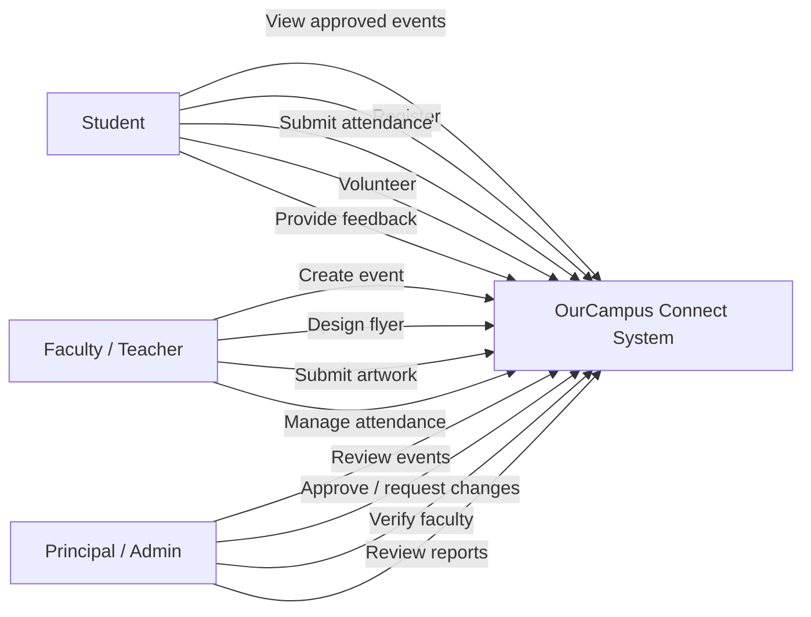
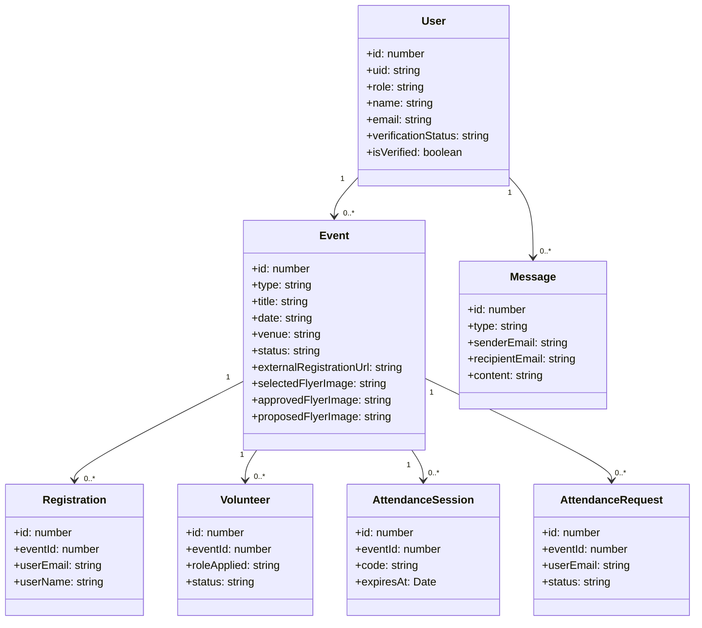
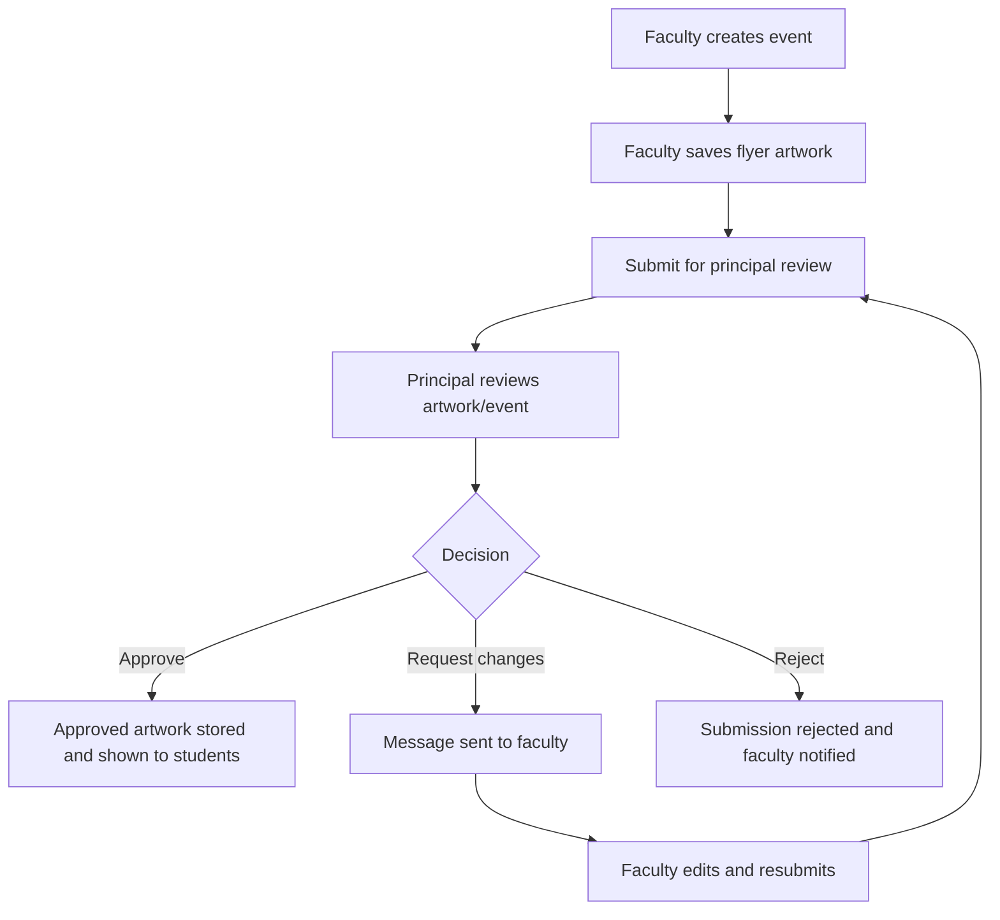
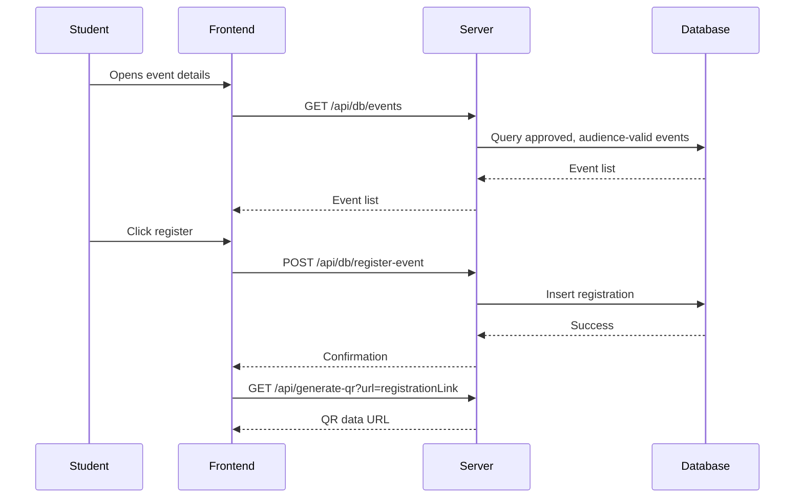
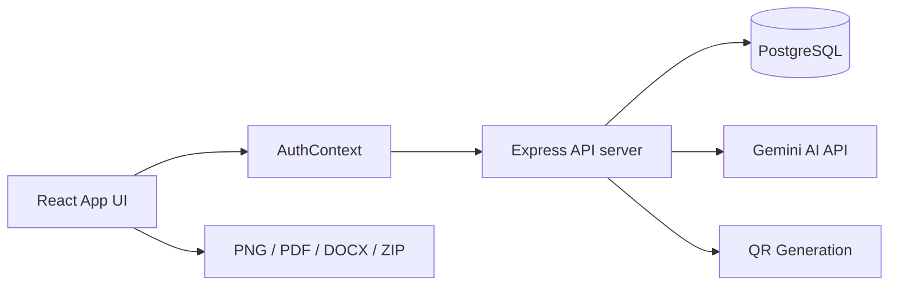
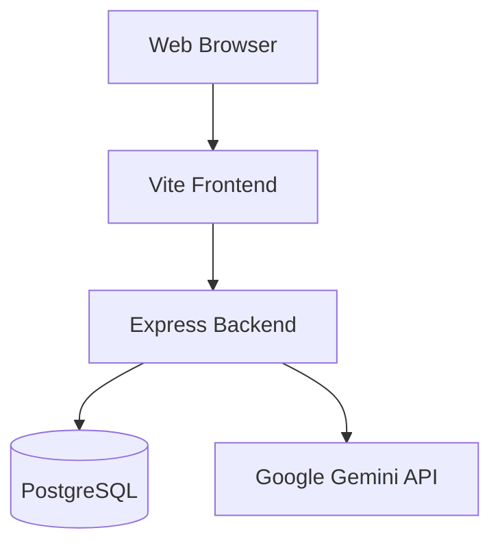
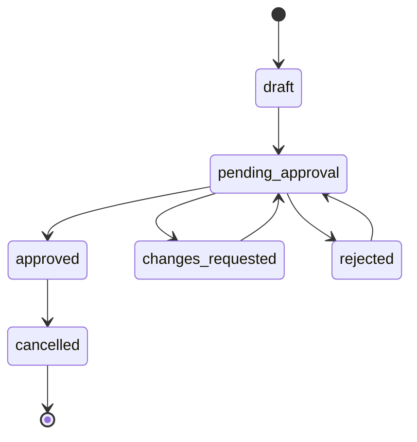
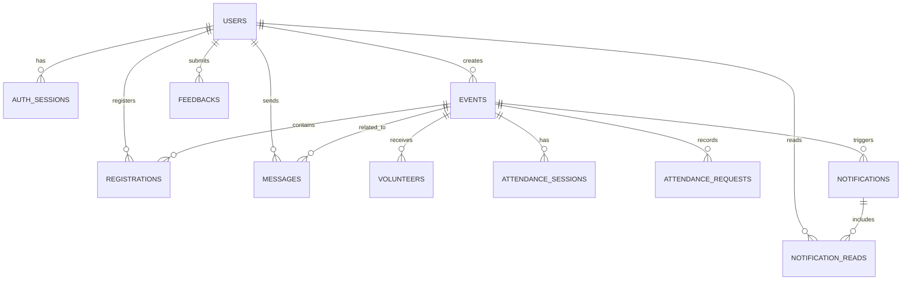
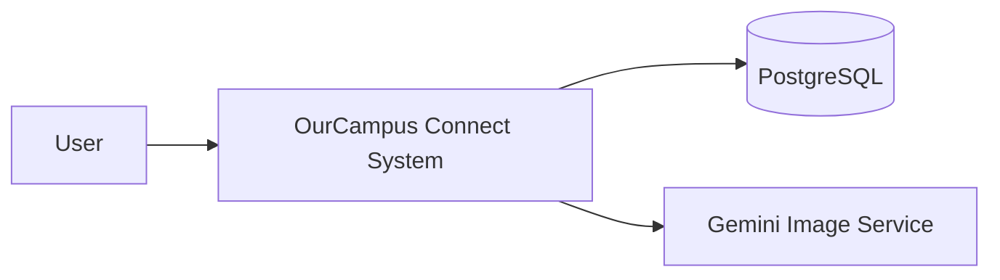
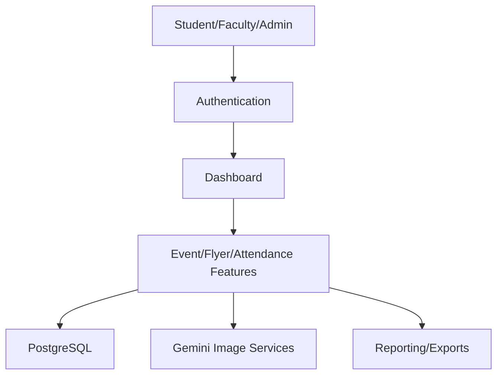

# OurCampus Connect — Complete Project Documentation

## 1. Project Overview

### 1.1 Abstract
OurCampus Connect is a full-stack college event management system implemented in the current workspace as a React + Vite front end and an Express + Node.js back end with PostgreSQL persistence via Drizzle ORM. The application supports student registration, faculty event creation, principal review and approval, attendance tracking, notifications, messaging, volunteer workflows, and flyer generation for events and seminars.

### 1.2 Problem Statement
Educational institutions often manage events, seminars, volunteer participation, attendance verification, and approvals across multiple roles with disconnected tools. A college needs a single system that allows:
- students to discover and register for approved events,
- faculty to create and manage submissions,
- the principal to review and approve or request changes,
- organizers to run attendance and communication workflows without losing status visibility or audit trails.

### 1.3 Objectives
This project aims to provide a unified digital campus event platform with the following goals:
- role-based access for students, faculty, and principal/admin,
- event and seminar creation workflows,
- principal approval and revision requests,
- student audience filtering by class/department,
- attendance management with OTP-based session support,
- real QR code generation for event registration links,
- AI-assisted flyer generation using Gemini,
- export of flyer artwork and reports for the institution.

### 1.4 Scope
The implemented scope covers:
- authentication and session handling,
- user registration and faculty verification,
- event/seminar creation and modifications,
- events feed filtered by student class and approval status,
- principal review workflow,
- volunteer and attendance features,
- notifications and messages,
- flyer design, preview, QR code generation, and export actions,
- PostgreSQL data persistence and API-based interactions.

### 1.5 Existing System vs Proposed System
The current workspace already contains a usable system that is operational and integrated with the college workflow. The app differs from a generic booking platform because it includes role permissions and institutional workflows such as faculty verification, principal approval, student audience gating, and event artwork review.

### 1.6 Feasibility
The project is feasible because the implementation is already present in the codebase and validated by the installed toolchain:
- React frontend for UI rendering,
- Express backend for routes and business logic,
- PostgreSQL through Drizzle ORM,
- Node.js environment with Vite build and TypeScript checks,
- existing runtime logic for QR, AI image generation, and event operations.

### 1.7 Advantages
- centralizes student and faculty workflows,
- ensures principal review before public visibility,
- supports class-appropriate event filtering,
- handles event artwork submission and revision loops,
- stores user and event data in a relational database,
- provides export/reporting support and notification flow.

### 1.8 Limitations
From the source code and testing evidence, the current project has the following limitations or unverified areas:
- browser automation for file download/share dialog verification is not configured,
- no automated end-to-end UI tests for QR export and principal approval in a browser session are present,
- Gemini AI generation depends on valid API configuration and quota,
- file download/share behaviors are implemented but not fully browser-validated in this environment,
- the app depends on a live PostgreSQL database for persistence.

### 1.9 Future Enhancements
- stronger automated UI test coverage,
- direct QR image validation in browser export flows,
- richer analytics dashboards,
- multi-college rollouts and tenant support,
- stronger PDF/ZIP security and signing,
- better admin audit trails and bulk operations.

---

## 2. System Modules

### 2.1 Authentication and Session Module
Files involved:
- `server.ts`
- `src/auth/*.ts`
- `src/context/AuthContext.jsx`

Purpose:
- register users,
- log in users,
- manage authenticated sessions through signed cookies,
- validate role permissions,
- enforce faculty verification status before access to certain features.

Key behavior:
- users include `student`, `teacher`, and `admin` roles,
- `requireAuth`, `requireRole`, `requireSameOrigin`, and `requireVerifiedFaculty` are used in `server.ts`,
- session tokens are hashed before storage.

### 2.2 Student Module
Files involved:
- `src/pages/StudentDashboard.jsx`
- `src/components/EventCard.jsx`
- `src/components/EventDetailModal.jsx`
- `src/components/AttendanceModal.jsx`
- `src/components/VolunteerModal.jsx`
- `src/components/FeedbackModal.jsx`

Purpose:
- view approved college events and seminars,
- filter and search them,
- register for valid events,
- participate in attendance verification,
- apply as volunteer,
- send messages to faculty and read relevant notifications,
- submit feedback.

### 2.3 Faculty / Teacher Module
Files involved:
- `src/pages/TeacherDashboard.jsx`
- `src/components/FlyerCreatorModal.jsx`
- `src/components/CollegeLogo.jsx`

Purpose:
- create events and seminars,
- manage submissions,
- upload official college logo,
- design or modify event flyer artwork,
- generate QR registration links,
- save and submit artwork for principal review,
- review faculty messages and manage attendance.

### 2.4 Principal / Admin Module
Files involved:
- `src/pages/AdminDashboard.jsx`
- `src/pages/Login.jsx` (admin bootstrap path)
- `server.ts` routes with `requireRole("admin")`

Purpose:
- review event submissions,
- approve, reject, or request changes,
- verify faculty accounts,
- review pending artwork submissions,
- monitor events, messages, volunteers, registrations, and reports.

### 2.5 Notification and Messaging Module
Files involved:
- `src/components/NotificationDrawer.jsx`
- `src/components/MessageModal.jsx`
- `server.ts`
- `src/db/schema.ts`

Purpose:
- send messages between faculty and principal or students and faculty,
- create notifications for role-based and audience-based updates,
- allow each user to view notifications filtered by role and class.

### 2.6 Event and Flyer Generation Module
Files involved:
- `src/components/FlyerCreatorModal.jsx`
- `server.ts` QR and Gemini routes
- `src/features/artworkRules.ts`

Purpose:
- choose flyer design template,
- load background image URL,
- generate AI artwork,
- generate QR code from the exact registration URL,
- compose final artwork,
- export PNG and PDF,
- share native flyer content when supported,
- save artwork for principal review.

### 2.7 Reporting and Export Module
Files involved:
- `server.ts`
- `src/pages/AdminDashboard.jsx`
- `src/pages/TeacherDashboard.jsx`
- `src/components/TechStackModal.jsx`

Purpose:
- generate DOCX report summaries for events,
- export project ZIP archive,
- provide event data downloads and institutional reporting features.

---

## 3. Technology Stack

### 3.1 Programming Languages
The project uses the following actual source-code languages:
- JavaScript / JSX for the React UI,
- TypeScript for server-side logic and validation modules,
- SQL for PostgreSQL schema and setup scripts,
- Markdown for project documentation.

### 3.2 Frontend Technologies
- React 19
- Vite 6
- JSX components under `src/`
- Tailwind-style utility classes and custom CSS styling
- `lucide-react` for icons
- `motion` package for UI transitions

### 3.3 Backend Technologies
- Node.js
- Express
- PostgreSQL
- Drizzle ORM
- `pg` PostgreSQL driver
- `dotenv` for environment configuration

### 3.4 AI and Image Technologies
- `@google/genai`
- Gemini API for image generation and recommendations
- `qrcode` for QR Code generation
- `html2canvas` for browser rendering to canvas
- `jspdf` for PDF export
- `docx` for DOCX reports

### 3.5 Development and Validation Tools
- TypeScript compiler (`tsc --noEmit`)
- Vite build pipeline
- `esbuild` for server bundling
- Node test runner (`node --test`)
- Drizzle schema tooling (`drizzle-kit`)

### 3.6 Key Oxides / Runtime Packages
The package manifest in `package.json` confirms the project includes: `@google/genai`, `drizzle-orm`, `express`, `firebase`, `firebase-admin`, `html2canvas`, `jspdf`, `lucide-react`, `pg`, `qrcode`, `react`, `react-dom`, `vite`, and TypeScript.

---

## 4. System Architecture

### 4.1 High-Level Architecture
The software is structured as a layered application:
1. Client-side React app renders dashboards and user flows.
2. Auth context holds session and user state and makes API calls.
3. Express server handles routes, authorization, and data access.
4. PostgreSQL stores user, event, attendance, message, notification, and feedback data.
5. External services such as Gemini and QR generation are called from the server side when needed.

### 4.2 Frontend-Backend Communication
The frontend calls REST endpoints in `server.ts` using `fetch` with `credentials: 'same-origin'`. Most responses are JSON with fields such as `success`, `message`, and domain-specific data.

### 4.3 Authentication and Authorization
Authentication is based on session cookies stored on the server side in `auth_sessions`. The server resolves the cookie to a user, checks the role, and applies `requireRole`, `requireVerifiedFaculty`, and `requireSameOrigin` as needed.

### 4.4 Session Management
The session manager is implemented in `src/auth/sessions.ts`. It:
- creates session tokens,
- hashes tokens before saving,
- validates expiration,
- revokes expired or explicit logout sessions,
- sanitizes user payloads before returning them to the browser.

### 4.5 RBAC Model
The role model used by the source is:
- `student`: event participation, registration, attendance, messaging, feedback
- `teacher`: event creation, flyer submission, review of own events, attendance management
- `admin`: principal-level review, faculty verification, system clean-up and audit access

---

## 5. Database Documentation

### 5.1 Database Technology
The project uses PostgreSQL and Drizzle ORM, as shown in `package.json`, `src/db/schema.ts`, and `src/db/index.ts`.

### 5.2 Main Tables
From `src/db/schema.ts` the database includes the following tables:

#### `users`
Purpose: all account information for students, faculty, and principal/admin.
Key columns:
- `id` (serial, primary key)
- `uid` (text, unique)
- `role` (text, not null)
- `name` (text, not null)
- `email` (text, not null, unique)
- `password` (text)
- `passwordHash` (text)
- `rollNo`, `facultyId`, `adminId`
- `studentClass`, `stream`, `department`
- `adminRole`, `phone`, `avatar`
- `isVerified`, `verificationStatus`, `createdAt`

#### `auth_sessions`
Purpose: stores hashed session tokens.
Fields:
- `tokenHash` (primary key)
- `userId` (foreign key to `users.id`)
- `expiresAt` (timestamp)
- `createdAt` (timestamp)

#### `events`
Purpose: event and seminar records.
Important fields:
- `id`
- `type` (`event` or `seminar`)
- `programmeType`
- `title`, `subHeadline`, `category`, `department`
- `dateMode`, `date`, `endDate`, `multipleDates`
- `time`, `venue`, `description`, `highlights`
- `resourcePerson`, `forWhom`, `prizes`
- `contact`, `socialHandle`
- `image`, `collegeLogo`, `deptLogo`
- `maxSeats`, `registrationEnabled`, `ticketPrice`, `eligibility`, `registrationDeadline`
- `externalRegistrationUrl`, `qrCodeUrl`
- `targetAudience`, `attendanceEnabled`
- `status` (`pending_approval`, `changes_requested`, `approved`, etc.)
- `principalMessage`
- `flyerData`, `flyerVersions`, `selectedFlyerImage`
- `proposedFlyerImage`, `approvedFlyerImage`
- `proposedCoverImage`, `approvedCoverImage`
- `flyerReviewStatus`, `coverReviewStatus`, `flyerReviewMessage`
- `createdBy`, `creatorEmail`, `creatorName`, `createdAt`

#### `registrations`
Purpose: stores which students registered for which event.
Fields:
- `id`, `eventId`, `userEmail`, `userName`, `rollNo`, `studentClass`, `registeredAt`

#### `volunteers`
Purpose: volunteer application tracking.
Fields:
- `id`, `eventId`, `userEmail`, `userName`, `roleApplied`, `reason`, `skills`, `status`, `appliedAt`

#### `attendanceSessions`
Purpose: generates timed OTP attendance sessions.
Fields:
- `id`, `eventId`, `code`, `expiresAt`, `isActive`, `createdAt`

#### `attendanceRequests`
Purpose: stores attendance verification submissions by students.
Fields:
- `id`, `sessionId`, `eventId`, `userEmail`, `userName`, `rollNo`, `studentClass`, `status`, `submittedAt`, `approvedAt`

#### `messages`
Purpose: principal-to-faculty and student-to-faculty communication.
Fields:
- `id`, `type`, `senderEmail`, `senderName`, `senderRole`, `recipientEmail`, `recipientName`, `eventId`, `eventTitle`, `subject`, `content`, `isRead`, `createdAt`

#### `notifications`
Purpose: role-based and audience-based notifications.
Fields:
- `id`, `title`, `message`, `targetRole`, `targetAudience`, `recipientEmail`, `eventId`, `createdAt`

#### `notification_reads`
Purpose: tracks which notifications a user has read.
Fields:
- `notificationId`, `userId`, `readAt`

#### `feedbacks`
Purpose: event feedback records.
Fields:
- `id`, `eventId`, `userEmail`, `userName`, `eventTitle`, `rating`, `comment`, `createdAt`

### 5.3 Relationships
The main relationships visible in the schema are:
- `auth_sessions.userId -> users.id`
- `registrations.eventId -> events.id`
- `volunteers.eventId -> events.id`
- `attendanceSessions.eventId -> events.id`
- `attendanceRequests.eventId -> events.id`
- `messages.eventId -> events.id` (optional)
- `notifications.eventId -> events.id` (optional)
- `notification_reads.notificationId -> notifications.id`
- `notification_reads.userId -> users.id`

### 5.4 Constraints and Rules
The schema uses:
- primary keys on IDs,
- unique email and UID values where relevant,
- cascade delete for sessions and notification reads,
- status strings used for review and approval state management,
- role and verification fields for access control.

### 5.5 Data Lifecycle
- event data is created by faculty or admin,
- approval status is set to pending or changed by principal actions,
- student feeds only include approved events relevant to their class,
- submitted artwork is stored as data URLs in event columns,
- approved artwork is selected and shown to students using the logic in `getStudentApprovedArtwork()`.

---

## 6. Coding and APIs

### 6.1 Project Folder Structure
Key folders and files in the workspace:
- `server.ts` — Express server and core route logic
- `src/App.jsx` — main app entry and route/auth branching
- `src/context/AuthContext.jsx` — shared API and session state
- `src/pages/StudentDashboard.jsx` — student portal
- `src/pages/TeacherDashboard.jsx` — faculty dashboard
- `src/pages/AdminDashboard.jsx` — principal dashboard
- `src/components/` — UI and modals
- `src/db/schema.ts` — PostgreSQL schema
- `src/auth/` — auth/password/session logic and tests
- `src/features/` — validation, date, notification, and artwork rules
- `public/` and `database_setup.sql` — seed/schema support files

### 6.2 Important Backend Routes
From `server.ts` the core routes include:
- `GET /api/health` — application health check
- `GET /api/auth/session` — authenticated user session lookup
- `POST /api/auth/logout` — logout and cookie clearing
- `GET /api/generate-qr` — generate QR code as PNG data URL
- `POST /api/db/register` — register user
- `POST /api/db/login` — login user
- `GET /api/db/events` — fetch filtered events
- `POST /api/db/events` — create event or seminar
- `PUT /api/db/events/:id` — update event details
- `POST /api/db/events/:id/artwork` — save proposed flyer or cover image
- `POST /api/db/events/:id/flyer-review` — principal review for artwork
- `POST /api/db/events/:id/status` — approve/reject/request-changes on overall event
- `POST /api/db/register-event` — register student for event
- `GET /api/db/registrations` — fetch user registrations
- `POST /api/db/volunteer` — apply as volunteer
- `POST /api/db/attendance/start` — start attendance session
- `POST /api/db/attendance/request` — student attendance submission
- `GET /api/db/attendance/requests/:eventId` — attendance request list
- `GET /api/db/messages` and `POST /api/db/messages` — internal messages
- `GET /api/db/notifications` — read notifications
- `GET /api/reports/docx/:eventId` — DOCX event report export
- `GET /api/download-project-zip` — project ZIP download

### 6.3 Validation and Error Handling
The server validates:
- required form fields,
- password length and hashing,
- session and role middleware,
- event dates and values,
- image data URLs for flyer artwork and logos,
- URL values used for registration links and QR code generation,
- permission checks before modifying data.

### 6.4 Important Algorithms
The implementation includes:
- role-based event filtering using `isEventVisibleToStudent()` from `src/features/eventRules.ts`,
- student artwork gating using `getStudentApprovedArtwork()`,
- faculty ownership checks using `isFacultyEventOwner()`,
- event date validation and parsing using `parseEventDates()` and `isValidEventDateSelection()`,
- QR generation via `qrcode.toDataURL()`,
- PNG/PDF export via `html2canvas` + `jsPDF`,
- DOCX generation using `docx` in the server route.

---

## 7. Business Workflows

### 7.1 Login and Registration
The app supports:
- new user registration through the `/api/db/register` endpoint,
- login via `/api/db/login`,
- faculty verification control by principal/admin,
- default principal bootstrap based on `PRINCIPAL_REGISTRATION_KEY`.

### 7.2 Event and Seminar Creation
Faculty users can:
- create event or seminar records,
- define scheduling and audience settings,
- set registration link values,
- save the organizer’s event details,
- later edit or resubmit after requested changes.

### 7.3 Flyer Generation and QR Workflow
The flyer workflow implemented in `FlyerCreatorModal.jsx` includes:
- template selection,
- background URL load support,
- college logo handling,
- QR generation from the exact registration URL,
- preview composition,
- export to JPG/PDF,
- share fallback behavior,
- save/submit artwork for principal review.

The actual QR target value is resolved from event fields using `resolveEventRegistrationUrl()`, which checks for the exact URL stored in `externalRegistrationUrl`, `qrCodeUrl`, `registrationUrl`, and saved flyer data.

### 7.4 Principal Approval Workflow
The principal can:
- view all pending items,
- approve, reject, or request changes,
- leave a message to the faculty,
- trigger notification creation and messaging updates.

Status values used by source code include:
- `pending_approval`
- `changes_requested`
- `approved`
- `rejected`
- `cancelled`

Artwork review statuses include:
- `pending_review`
- `approved`
- `rejected`
- `changes_requested`
- `not_submitted`

### 7.5 Student Event Visibility
Student visibility is intentionally restricted by `isEventVisibleToStudent()` and `getStudentApprovedArtwork()`:
- only approved events matching the student’s audience are shown,
- only approved artwork is displayed to students,
- faculty or draft artwork is hidden from the student-facing event list.

### 7.6 Attendance Module
Faculty/admin can start attendance sessions with an OTP code; students submit attendance requests. Attendance status moves through values such as `Pending`, `Present`, and `Rejected`.

### 7.7 Volunteer Workflow
Students can apply for event volunteer roles. Teacher and admin users can then change the status of the volunteer application.

### 7.8 Notifications and Messaging
Messages and notifications are generated from actions such as:
- principal review decisions,
- faculty verification decisions,
- event updates,
- attendance and approval actions.

---

## 8. UML and System Diagrams

The following diagrams are valid Mermaid source for the current implementation and are based on the actual code and schema.

### 8.1 Use Case Diagram


### 8.2 Class Diagram


### 8.3 Activity Diagram: Event Approval Flow


### 8.4 Sequence Diagram: Student Registration and QR Flow


### 8.5 Component Diagram


### 8.6 Deployment Diagram


### 8.7 State Diagram: Event Status


### 8.8 ER Diagram


### 8.9 Data Flow Diagram (Level 0 and Level 1)




---

## 9. Security and Testing

### 9.1 Password Handling
Password logic is implemented in `src/auth/passwords.ts`. The code verifies a hash and supports legacy password upgrade logic. The tests confirm hashing, password normalization, and malformed hash rejection.

### 9.2 Authentication and Authorization
The server uses guard middleware to enforce access:
- `requireAuth`
- `requireRole`
- `requireSameOrigin`
- `requireVerifiedFaculty`

This prevents unauthorized access and restricts faculty-only flows to verified faculty accounts.

### 9.3 Input Validation
The project validates:
- user email and registration keys,
- password length,
- event date selections,
- image data URLs,
- URL format for registration links and QR generation,
- flyer design shape and allowed values.

### 9.4 Environment Variables
The available environment variable names in the project are:
- `GEMINI_API_KEY`
- `APP_URL`
- `SQL_HOST`
- `SQL_DB_NAME`
- `SQL_USER`
- `SQL_PASSWORD`
- `DATABASE_URL`
- `PRINCIPAL_REGISTRATION_KEY`

No secret values are included in this project documentation.

### 9.5 Error Handling
The codebase returns JSON error responses with clear messages for invalid input, missing auth, unauthorized access, and route failures. It does not expose stack traces to end users in normal API responses.

### 9.6 Tests Actually Run and Verified
The workspace contains tests under `src/auth` and `src/features` for:
- session logic,
- password logic,
- registration key validation,
- artwork validation,
- event date logic,
- notification visibility logic,
- faculty ownership checks.

Actual results from the executed test run:
- `node --test .\src\auth\*.test.ts .\src\features\*.test.ts`
- Result: 32 tests passed; 0 failed.

Actual results from run scripts in `package.json`:
- `npm run lint` — passed
- `npm run build` — passed

### 9.7 Known Security/Testing Caveats
- browser-level file download/share flows were not executed in a live browser session within this environment,
- end-to-end principal approval plus student visibility in a UI browser session was not available here,
- no Playwright/Cypress browser automation suite exists in the project manifest,
- the Gemini service is externally dependent and quota/key sensitive.

---

## 10. Setup and Deployment

### 10.1 Prerequisites
- Node.js installed
- PostgreSQL database instance
- valid environment variables for DB connection and Gemini
- working browser to access the React app

### 10.2 Installation
From the project root:
```bash
npm install
```

### 10.3 Database Setup
The project includes a SQL setup script and Drizzle migration tooling:
```bash
npm run db:generate
npm run db:push
```

The actual schema is defined in `src/db/schema.ts` and supported by `database_setup.sql`.

### 10.4 Running the Application
Development mode:
```bash
npm run dev
```

Production build:
```bash
npm run build
npm run start
```

### 10.5 Linting and Validation
```bash
npm run lint
```

### 10.6 Deployment Architecture
The application is built as a standard Node.js app served from `dist/server.cjs` after the Vite build. The front-end is static assets served from the Vite build output, and the backend is the bundled Express server.

### 10.7 Troubleshooting
Likely issues based on the actual code:
- ensure `GEMINI_API_KEY` is set for AI-assisted flyer generation,
- ensure PostgreSQL is running and `DATABASE_URL` / SQL env variables are valid,
- ensure `PRINCIPAL_REGISTRATION_KEY` is set for initial principal bootstrapping,
- ensure faculty accounts are verified before accessing artwork submission features,
- ensure `externalRegistrationUrl` or `qrCodeUrl` is a valid HTTP/HTTPS URL for QR generation.

---

## 11. Project Reference

### 11.1 Functional Requirements Met
The implemented code supports the following functional requirements from the workspace:
- student registration and attendance,
- teacher event and seminar creation,
- principal approval flow,
- real QR code generation and flyer artwork composition,
- AI-generated flyer cover support,
- notifications/messages,
- event reports and ZIP export,
- role-based access control.

### 11.2 Non-Functional Requirements
- secure session handling,
- input validation,
- role checks,
- data persistence via PostgreSQL,
- modular React component structure,
- build-time type-checking and test validation.

### 11.3 Glossary
- Event: a general college event.
- Seminar: a teaching/training/workshop-like academic event.
- Faculty verification: principal approval for teacher access to event features.
- QR URL: the exact external registration URL assigned to an event for student registration.
- Approved artwork: the final image chosen by the principal for display to students.

### 11.4 Conclusion
OurCampus Connect is a functional, source-backed college event management platform that integrates frontend, backend, DB, and external AI/QR services. The project contains real implementation for the major institutional workflows and passes its repository test, lint, and production build commands. Some browser-only validations remain unverified in this environment and are clearly labelled as such.

### 11.5 Relevant Source Files
- `server.ts`
- `src/db/schema.ts`
- `src/context/AuthContext.jsx`
- `src/pages/StudentDashboard.jsx`
- `src/pages/TeacherDashboard.jsx`
- `src/pages/AdminDashboard.jsx`
- `src/components/FlyerCreatorModal.jsx`
- `src/features/artworkRules.ts`
- `src/features/eventRules.ts`
- `src/auth/sessions.ts`
- `package.json`
- `.env.example`
- `DOWNLOAD_SHARE_AUDIT.md`
- `OURCAMPUS_CONNECT_COMPLETE_PROJECT_REPORT.md`

---

## 12. Documentation Checklist

Completed sections:
- [x] Project overview
- [x] System modules
- [x] Technology stack
- [x] System architecture
- [x] Database documentation
- [x] Coding and APIs
- [x] Business workflows
- [x] UML and system diagrams
- [x] Security and testing
- [x] Setup and deployment
- [x] Project reference and conclusion

### 12.1 Information Not Directly Verified from Project Files
The following items are clearly identified as not fully browser-verified in the current environment:
- live browser download and native share action completion,
- actual click-through principal review in a browser session,
- final student UI visibility after approval in a live browser,
- end-to-end QR scan verification on the exported PNG/PDF art in a browser session.

These are implemented in source, tested where possible at the code and library level, and documented as not runtime-verified in this environment.
